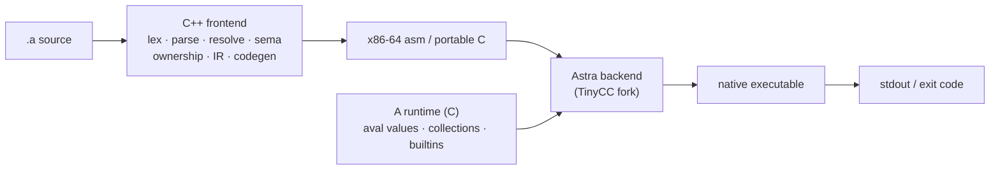

<div align="center">

# A

**A fast, batteries-included programming language and toolchain** — lexer, parser,
type checker, ownership analysis, SSA optimizer, and a TinyCC-derived backend that
compiles A straight to native machine code.

[](https://github.com/ALangLabs/A/actions/workflows/ci.yml)
[](LICENSE)
[](#)
[](#)

[Features](#-features) • [Quick start](#-quick-start) • [The language](#-the-language) • [Toolchain](#-toolchain) • [Architecture](#-architecture) • [Documentation](#-documentation) • [Development](#-development)

</div>

---

## ✨ Features

- **Native compilation, no runtime VM** — `a build` lowers A to machine code
  and links a real executable through the bundled **Astra** backend (a TinyCC
  fork). `a run` does the same and executes it. x86-64 uses a dedicated
  assembly emitter; other architectures go through a portable C emitter that
  Astra compiles per target.
- **Multi-target builds** — `a build --target <arch>` cross-compiles for
  i386, AArch64 (`aarch64`/`arm64`) and RISC-V64 on the host OS, given a
  matching target sysroot (see *Cross-compilation* below).
- **Static type checking with inference** — Hindley-Milner-style unification,
  generics, traits, algebraic enums, optional/result types, and flow-sensitive
  narrowing (`if x != None`).
- **Ownership & borrowing** — move semantics, `borrow`/`borrow_mut`, and
  compile-time view (slice) tracking, checked after type inference.
- **Rich standard library** — collections, math, JSON, binary codec, filesystem,
  HTTP/net, logging, metrics, tracing, terminal, time, testing, and more —
  written in A under [`stdlib/`](stdlib/).
- **Python interop** — `import python:<pkg>` calls into CPython at run time via
  a `dlopen`'d libpython bridge (NumPy, PyTorch, …), including zero-copy
  buffer-protocol views.
- **Self-hosted kernels** — numeric kernels (matmul, attention, conv, softmax,
  quantization, …) written in A under [`kernels/`](kernels/).
- **First-class tooling** — `a fmt`, `a doc`, `a ir`, a REPL, a full **LSP**
  server (`a-lsp`), and a VS Code extension.
- **LLVM-style optimization pipeline** — constant folding, DCE, inlining, LICM,
  CSE, instcombine, SCCP, and `-O0`…`-Ofast` levels over a typed SSA IR.

## 🚀 Quick start

```sh
# Build the toolchain (produces build/a and build/a-lsp)
cmake -S . -B build -DCMAKE_BUILD_TYPE=Release -DA_WARNINGS_AS_ERRORS=ON
cmake --build build -j

# Compile and run a program
./build/a run examples/basics/hello.a

# Type-check without running
./build/a check path/to/file.a

# Produce a native binary
./build/a build path/to/file.a -o myapp
```

Or use the helper script: `tooling/build/build.sh`.

### The `a` CLI

| Command | Description |
| --- | --- |
| `a run <file.a>` | Compile and execute (`-c 'code'` for inline source) |
| `a build <file.a> -o <bin>` | Compile to a native executable |
| `a check <file.a>` | Type-check only (`--json` for machine-readable diagnostics) |
| `a test <file.a>` | Discover and run every `fn test_*()` |
| `a fmt <file.a>` | Format source (`-w` in place, `--check` for CI) |
| `a doc <file.a>` | Generate documentation (`--json` supported) |
| `a ir <file.a>` | Print the typed SSA IR (`--opt` / `-O*` to optimize) |
| `a repl` | Interactive REPL (self-hosted shell on a TTY) |

Common flags: `-I <dir>` module search path, `--stdlib <dir>`, `-j/--jobs`,
`-O0/-O1/-O2/-O3/-Os/-Oz/-Ofast`, `--optnone`, `--no-color`.

## 📝 The language

A is a statically typed, indentation-sensitive language with Python-like
syntax and native performance. A quick tour:

```python
import std:math

class Point:
    x: float
    y: float

    fn length(self) -> float:
        return math.sqrt(self.x * self.x + self.y * self.y)

fn fib(n: int) -> int:
    if n < 2:
        return n
    return fib(n - 1) + fib(n - 2)

fn main():
    p = Point(3.0, 4.0)
    print("length:", p.length())          # 5.0
    print("fib(20):", fib(20))            # 6765
    print("squares:", [x * x for x in 0..5])

main()
```

Highlights: `class` types with fields, methods, and inheritance, `enum` (plain and
algebraic), `trait` + `impl` conformance, generics and `comptime` params,
closures/lambdas, comprehensions, `match` expressions, `?` optionals and
`Result`, slices/views, `defer`, destructuring, string interpolation, and
`#` comments with `##` doc comments.

## 🧰 Toolchain



- **`compiler/astra/frontend/`** — the C++20 frontend (`namespace a`): lexer,
  parser, AST, diagnostics, module loader, `Sema` type checker, ownership
  analysis, typed SSA IR + optimizer, and the `AsmEmitter` assembly backend.
- **`compiler/astra/backend/`** — **Astra**, a TinyCC fork: the `astra` driver,
  the `libastra` library API, per-target code generators (x86-64, ARM, AArch64,
  RISC-V, i386, C67x), ELF/Mach-O/COFF writers, and support libraries.
- **`compiler/astra/runtime/`** — the C runtime every A program links:
  NaN-boxed `aval` values, collections, builtins, and native modules
  (json, fs, net, arena, unsafe, python interop, terminal, time, intrinsics).
- **`tools/lsp/`** — `a-lsp`, a full stdio language server (diagnostics,
  hover, go-to-definition, completion, formatting, call/type hierarchy, …).
- **`tools/vscode-a/`** — VS Code extension with syntax highlighting,
  snippets, tasks, and the LSP client.

## 🎯 Targets & cross-compilation

`a build --target <arch>` selects the output architecture (the OS always
matches the host — Astra drivers are built per-OS and cannot cross
operating systems):

| Target | Backend | Status |
|---|---|---|
| `x86_64` (default) | x86-64 asm emitter → `astra` | native, fully tested |
| `i386` | portable C emitter → `astra-i386` | verified (runs natively on x86-64) |
| `arm` (ARMv7 hard-float) | portable C emitter → `astra-arm` | verified under qemu-armhf |
| `aarch64` / `arm64` | portable C emitter → `astra-arm64` | needs AArch64 sysroot |
| `riscv64` | portable C emitter → `astra-riscv64` | needs RISC-V64 sysroot |

`a run`, `a test` and `a repl` always execute natively and reject non-host
targets. Linking a cross binary requires the target C library: install the
matching cross toolchain (e.g. `gcc-aarch64-linux-gnu`, `libc6-dev-i386`)
or point `A_SYSROOT` / `A_SYSROOT_<ARCH>` at a sysroot root. Per-arch Astra
drivers and staged lib dirs are produced by the build (`build/astra/astra-<arch>`,
`build/astralib-<arch>/`); `A_ASTRA_<ARCH>` overrides the driver lookup.

Not supported: RISC-V32 (no astra backend; the runtime value model is
64-bit) and 16-bit (no libc/runtime environment exists for it). Windows
has a first-pass `_WIN32` port of the driver pipeline (`CreateProcess`,
`GetTempPath`, `GetModuleFileName` in `pipeline.cpp`) but is untested —
it still needs a Windows astra driver build, PE link verification, and a
Win32 test-mode harness in the C emitter (`a test` emits POSIX
`fork`/`waitpid` today). Debian `*-cross` sysroots ship `libc.so`/
`libm.so` linker scripts with absolute paths astra cannot resolve — rewrite
the `GROUP` entries relative to the sysroot lib dir when setting one up.

`tests/integration/cross_suite.sh <arch> <sysroot-env> <sysroot> [runner]`
cross-compiles every runnable integration case for a target and diffs
program output — verified 70/70 on i386 (native), arm, aarch64 and riscv64
(under qemu-user).

## 📚 Documentation

- **[Technical wiki](docs/wiki/index.md)** — deep-dive pages for every
  subsystem: frontend stages, backend, runtime, stdlib, kernels, tooling,
  tests, and examples.
- **[`examples/`](examples/)** — runnable programs by category (basics,
  control flow, classes, enums, modules, stdlib, Python interop, …).
- **[`stdlib/std/`](stdlib/std/)** — standard library packages.
- **[`tests/integration/cases/`](tests/integration/cases/)** — golden test
  suite doubles as feature documentation.

## 🧪 Development

```sh
# Full build + test
cmake -S . -B build -DCMAKE_BUILD_TYPE=Release -DA_WARNINGS_AS_ERRORS=ON
cmake --build build -j
ctest --test-dir build --output-on-failure

# Targeted checks
tests/integration/run_tests.sh build/a          # golden suite only
python3 tools/lsp/smoke_test.py build/a-lsp     # LSP smoke test
```

CI (`.github/workflows/ci.yml`) builds with warnings-as-errors, verifies
version consistency across all components, runs the full test suite, and runs
an ASan/UBSan pass.

Conventions: C++20 in `namespace a`, headers next to implementations,
conventional-commit style (`fix(sema): …`, `feat(lsp): …`), and version bumps
must update `CMakeLists.txt`, `frontend/driver/version.hpp`,
`tools/lsp/server.cpp`, and `tools/vscode-a/package.json` together. See
[`AGENTS.md`](AGENTS.md) for the full contributor guide.

## 📄 License

[MIT](LICENSE) © 2026 OEvortex / ALangLabs.
