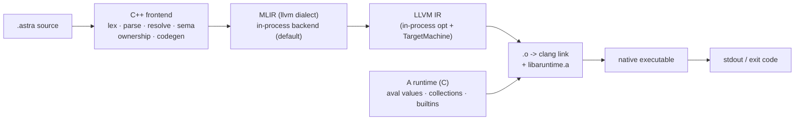

<div align="center">

# A

**A fast, batteries-included programming language and toolchain** — lexer, parser,
type checker, ownership analysis, and an LLVM-based backend that
compiles A straight to native machine code.

[](https://github.com/ALangLabs/A/actions/workflows/ci.yml)
[](LICENSE)
[](#)
[](#)

[Features](#-features) • [Quick start](#-quick-start) • [The language](#-the-language) • [Toolchain](#-toolchain) • [Architecture](#-architecture) • [Documentation](#-documentation) • [Development](#-development)

</div>

---

## ✨ Features

- **Native compilation, no runtime VM** — `a build` lowers A to machine code
  and links a real executable. x86-64 SysV (Linux, macOS) lowers through MLIR's
  llvm dialect (`frontend/mlir/`, the default `mlir-direct` backend) to LLVM IR
  and compiles via `opt`/`llc`/`clang` (host targets; cross-compile is not yet
  supported). A declined construct is a hard error — there is no fallback.
- **Multi-target builds** — `a build --target <arch>` accepts the host
  arch/os only today; the LLVM backend cannot cross-compile (see
  *Targets* below).
- **Static type checking with inference** — Hindley-Milner-style unification,
  generics, traits, algebraic enums, optional/result types, and flow-sensitive
  narrowing (`if x != None`).
- **Ownership & borrowing** — move semantics, `borrow`/`borrow_mut`, and
  compile-time view (slice) tracking, checked after type inference.
- **Rich standard library** — collections, math, JSON, binary codec, filesystem,
  HTTP/net, logging, metrics, tracing, terminal, time, testing, and more —
  A packages under [`stdlib/`](stdlib/) plus native runtime modules, reached
  through `import std:<pkg>`.
- **Python interop** — `import python:<pkg>` calls into CPython at run time via
  a `dlopen`'d libpython bridge (NumPy, PyTorch, …), including zero-copy
  buffer-protocol views.
- **Native ML kernels** — Mojo-inspired kernels (`matmul` block-tiled, fused
  `attention`/`softmax`, FMA hot loops).
- **First-class tooling** — `a fmt`, `a doc`, a REPL, a full **LSP**
  server (`a-lsp`), and a VS Code extension.
- **Package manager** — `apm` (`apm/apm`), `pip` for A: install, update,
  publish, and run third-party packages written in A itself, with a
  registry index, `apm.json` manifests, and `apm.lock.json` pinning.
  See [`apm/`](apm/README.md).
- **LLVM-style optimization pipeline** — `-O0`…`-Ofast` levels forwarded to
  the LLVM backend.

## 🚀 Quick start

### Install

Prebuilt binaries are published on
[GitHub Releases](https://github.com/ALangLabs/A/releases). The installers
drop `a`, `a-lsp`, the staged runtime (`astralib/`), and the stdlib under `~/.local`
(Linux/macOS) or `%LOCALAPPDATA%\Programs\A` (Windows), put them on `PATH`,
and install the editor extension into every detected VS Code or fork
(Cursor, Windsurf, VSCodium, …):

```sh
# Linux / macOS
curl -fsSL https://raw.githubusercontent.com/ALangLabs/A/main/install/install.sh | sh

# Windows (PowerShell)
irm https://raw.githubusercontent.com/ALangLabs/A/main/install/install.ps1 | iex
```

Options: `--prefix DIR` / `A_PREFIX` to relocate, `--no-extension` /
`A_NO_EXTENSION=1` to skip the editor step, `A_VERSION` to pin a release.
To build from source instead, continue below.

### Build from source

```sh
# Build the toolchain (produces build/a and build/a-lsp)
cmake -S . -B build -DCMAKE_BUILD_TYPE=Release -DA_WARNINGS_AS_ERRORS=ON
cmake --build build -j

# Compile and run a program
./build/a run examples/basics/hello.astra

# Type-check without running
./build/a check path/to/file.astra

# Produce a native binary
./build/a build path/to/file.astra -o myapp
```

`cmake --build build -j` builds everything in `all`, including `a-lsp`
(use `--target a` or `--target a-lsp` to build just one binary). Link-time
optimization is **off by default** so dev builds stay fast; for release
builds add `-DA_ENABLE_LTO=ON` to the configure step.

Or use the helper script: `tooling/build/build.sh`.

### The `a` CLI

| Command | Description |
| --- | --- |
| `a run <file.astra>` | Compile and execute (`-c 'code'` for inline source) |
| `a build <file.astra> -o <bin>` | Compile to a native executable |
| `a check <file.astra>` | Type-check only (`--json` for machine-readable diagnostics) |
| `a test [file|dir]` | Discover and run `fn test_*()` in a file, or recursively in a directory/codebase (default: `.`); `--filter <substr>` selects by name |
| `a fmt <file.astra>` | Format source (`-w` in place, `--check` for CI) |
| `a doc <file.astra>` | Generate documentation (`--json` supported) |
| `a repl` | Interactive REPL (self-hosted shell on a TTY) |

Common flags: `-I <dir>` module search path, `--stdlib <dir>`, `-j/--jobs`,
`-O0/-O1/-O2/-O3/-Os/-Oz/-Ofast`, `--optnone`, `--no-color`.

## 📝 The language

A is a statically typed, indentation-sensitive language with Python-like
syntax and native performance. A quick tour:

```python
import std:math

class Point:
    x: float
    y: float

    fn length(self) -> float:
        return math.sqrt(self.x * self.x + self.y * self.y)

fn fib(n: int) -> int:
    if n < 2:
        return n
    return fib(n - 1) + fib(n - 2)

entry main():
    p = Point(3.0, 4.0)
    print("length:", p.length())          # 5.0
    print("fib(20):", fib(20))            # 6765
    print("squares:", [x * x for x in 0..5])
```

`entry name():` is the program entry point — invoked once after the entry
file's top-level statements and imports initialize. It runs only for the
file you pass to `a run`/`a build`, never for imported modules, and is
skipped by `a test` (which discovers `fn test_*()` instead). Top-level
statements still run on import, so keep library modules declaration-only;
put program logic in `entry`.

Highlights: `class` types with fields, methods, and inheritance, `enum` (plain and
algebraic), `trait` + `impl` conformance, generics and `comptime` params,
closures/lambdas, comprehensions, `match` expressions, `?` optionals and
`Result`, slices/views, `defer`, destructuring, string interpolation, and
`#` comments and `"""..."""` docstrings.

## 🧰 Toolchain



- **`src/astra/frontend/`** — the C++20 frontend (`namespace a`): lexer,
  parser, AST, diagnostics, module loader, `Sema` type checker, ownership
  analysis, and the native code emitters
  (`emitMLIR` -> MLIR llvm dialect, compiled **in-process** by default:
  parse -> LLVM IR -> `llvm::PassBuilder` opt -> `TargetMachine` -> `.o`
  -> `clang` link with `libaruntime.a`, host targets only; the
  `mlir-translate`/`opt`/`llc`/`clang` subprocess chain remains via
  `A_BACKEND=subprocess` or `A_MLIR_NATIVE=0`; a sibling `.ambc`
  precompiled package (`a precompile`) is consumed automatically on
  non-Windows, `A_AMBC=0` disables — re-run `a precompile` after
  changing any imported module since packages don't track deps;
  `emitLLVM` remains as the `A_BACKEND=llvm` debug fallback;
  `cmake/aruntime.cmake` stages `src/astra/runtime/*.c` into
  `build/astralib/libaruntime.a`, which every compiled program links).
- **`src/astra/mlir/`** *(in progress)* — the Mojo/KGEN-style in-process
  MLIR backend: the `a` dialect, lowering passes, `.ambc` bytecode
  packaging (`a precompile`, `A_AMBC=1`), and an opt-in in-process
  LLVM bridge (`A_MLIR_NATIVE=1` / `A_BACKEND=mlir-native`) that replaces
  the `mlir-translate`/`opt`/`llc` subprocess chain. Debug entry point:
  `a mlir-opt <file.mlir|file.ambc>`; golden tests in `tests/mlir/`.
  See `docs/mlir-architecture.md`.
- **`src/astra/runtime/`** — the C runtime every A program links:
  NaN-boxed `aval` values, collections, builtins, and native modules
  (json, fs, net, arena, unsafe, python interop, terminal, time, intrinsics).
- **`tools/lsp/`** — `a-lsp`, a full stdio language server (diagnostics,
  hover, go-to-definition, completion, formatting, call/type hierarchy, …).
- **`apm/`** — `apm`, the package manager: registry index, dependency
  resolver, installer (local/git/http sources), lockfile, and the
  `apm` launcher script.
- **`tools/vscode-a/`** — VS Code extension with syntax highlighting,
  snippets, tasks, and the LSP client.

## 🎯 Targets

The LLVM backend is **host-only**: `a build`/`a run`/`a test`/`a repl`
produce and execute binaries for the host architecture and OS
(`x86_64` or `aarch64`/`arm64`). `a build --target <arch>` parses foreign
targets but rejects them with a clear error — there is no cross-compile
path and no per-arch assembler backend. RISC-V32, `i386`, `arm`, `riscv64`
and the bare-metal `i8086` target are all unsupported; the hand-written
`src/astra/runtime/i8086_runtime.s` subset remains in the tree for
reference only.

Windows is a supported host OS (x86-64 and arm64): the pipeline's
`_WIN32` ports (`CreateProcess`, `GetTempPath`, `GetModuleFileName` in
`pipeline.cpp`) produce and run PE32+ executables — `a run`/`a test`/
`a build` work, with `a test` taking the serial path (no fork-based
batching) and the runtime's parallel pool disabled. Runtime caveats on
Windows: TCP sockets work via Winsock2, but TLS/zlib stay unavailable
(no `dlopen`), `import python:<pkg>` interop is stubbed out, and
POSIX-only pieces like `terminal` raw mode degrade gracefully.

The staged runtime (`build/astralib/` in-tree, `<prefix>/astralib/` when
installed) contains copies of `src/astra/runtime/*` plus the
prebuilt `libaruntime.a` that `llvmBuild` links via `clang`; LLVM tools
are located via `A_LLVM_OPT`/`A_LLVM_LLC`/`A_LLVM_CC` or PATH.

## 📚 Documentation

- **[Technical wiki](docs/wiki/index.md)** — deep-dive pages for every
  subsystem: frontend stages, backend, runtime, stdlib, tooling,
  tests, and examples.
- **[`examples/`](examples/)** — runnable programs by category (basics,
  control flow, classes, enums, modules, stdlib, Python interop, …).
- **[`stdlib/std/`](stdlib/std/)** — standard library packages.
- **[`tests/integration/cases/`](tests/integration/cases/)** — golden test
  suite doubles as feature documentation.

## 🧪 Development

```sh
# Full build + test
cmake -S . -B build -DCMAKE_BUILD_TYPE=Release -DA_WARNINGS_AS_ERRORS=ON
cmake --build build -j
ctest --test-dir build --output-on-failure

# Release/perf build: LTO is off by default (faster dev builds) — opt in with
#   -DA_ENABLE_LTO=ON on the configure step.

# Targeted checks
tests/integration/run_tests.sh build/a          # golden suite only
python3 tools/lsp/smoke_test.py build/a-lsp     # LSP smoke test
```

CI (`.github/workflows/ci.yml`) builds with warnings-as-errors, verifies
version consistency across all components, runs the full test suite, and runs
an ASan/UBSan pass.

Conventions: C++20 in `namespace a`, headers next to implementations,
conventional-commit style (`fix(sema): …`, `feat(lsp): …`), and version bumps
must update `CMakeLists.txt`, `frontend/driver/version.hpp`,
`tools/lsp/server.cpp`, and `tools/vscode-a/package.json` together. See
[`AGENTS.md`](AGENTS.md) for the full contributor guide.

## 📄 License

[MIT](LICENSE) © 2026 OEvortex / ALangLabs.
