# A toolchain — architecture overview

The A toolchain is a single-repository compiler and language ecosystem for the
**A** programming language. It is organized as three cooperating pieces:

1. **The `a` driver and C++ frontend** (`compiler/astra/frontend/`) — a C++20
   toolchain that lexes, parses, resolves modules, type-checks, runs ownership
   analysis, lowers to a typed SSA IR, and emits **x86-64 AT&T assembly**.
2. **The Astra backend** (`compiler/astra/backend/`) — a fork of TinyCC that
   assembles/compiles the emitted `.s` and the C runtime modules into a native
   machine-code executable. `libastra` (`libastra.h`) exposes the same
   compiler-as-a-library API as TinyCC's `libtcc`.
3. **The A runtime** (`compiler/astra/runtime/`) — C modules implementing the
   dynamic value model (`aval`, NaN-boxed 64-bit words), collections, builtins,
   and native modules (json, fs, net, python interop, ...). Every compiled A
   program links these in.

## Pipeline

```mermaid
flowchart LR
    subgraph CLI["a CLI (frontend/cli/main.cpp)"]
        cmd["a run / build / check / test / fmt / doc / ir / repl"]
    end
    subgraph Frontend["C++ frontend (compiler/astra/frontend)"]
        lex["lexer<br/>Lexer::tokenize"]
        parse["parser<br/>Parser::parseProgram"]
        load["name-resolution<br/>ModuleLoader::load"]
        sema["type-checker<br/>Sema::analyze"]
        own["ownership<br/>analyzeOwnership"]
        ir["ir + optimization<br/>lowerProgram / runOptPipeline"]
        cg["codegen<br/>emitAsm"]
    end
    subgraph Astra["Astra backend (compiler/astra/backend)"]
        astra["astra driver<br/>(TinyCC fork)"]
        asm["x86_64-asm / x86_64-gen / x86_64-link"]
        elf["astraelf / astramacho / astracoff"]
        rtlib["lib/libastra1.a + runmain.o"]
    end
    subgraph Runtime["A runtime (compiler/astra/runtime)"]
        rt["a_runtime.c + rt modules<br/>(core, value, methods, builtins, json, ...)"]
    end
    src[".a source"] --> lex --> parse --> load --> sema --> own
    own -->|"a check / a ir"| ir
    own -->|"a run / a build / a test"| cg
    ir -.->|"emit-ir only"| out_ir["IR text"]
    cg --> s["staged .s (AT&T)"]
    s --> astra
    astra --> asm --> elf --> exe["native binary"]
    rt -.->|"compiled by astra,<br/>linked into binary"| exe
    rtlib -.-> exe
    exe --> run["child process (fork/exec)"]
```



Key facts verified in code:

- `a run`, `a build`, and `a test` all go through
  `runFrontendPipeline` → `emitAsm` → `compileAndRun`/`astraBuild` in
  `compiler/astra/frontend/pipeline/pipeline.cpp`. The pipeline stages the
  assembly to `/tmp/a_gen_*` and invokes the staged `astra` driver
  (`findAstra()`, `A_ASTRA` override), which compiles the `.s` together with
  every `*.c` in the runtime directory (or the prebuilt `libaruntime.a` at `-O2`).
- `a check` stops after Sema + ownership; `a fmt`/`a doc` use the tooling
  module; `a ir` runs `ir::lowerProgram` (+ `runOptPipeline` with `--opt`);
  `a repl` re-compiles and re-runs the accumulated source per input.
- There is **no interpreter and no C-emission backend** in this checkout: the
  assembly emitter (`codegen/codegen.cpp`, `AsmEmitter`) is the only codegen
  path, and it fails on constructs outside its covered subset.
- The IR (`ir/`) and optimizer (`optimization/`) are exercised by `a emit-ir`-style
  flows and `tests/ir/ir_tests.cpp`; they are not on the `a run` path.

## Repository layout

| Path | Contents |
| --- | --- |
| `compiler/astra/frontend/` | C++20 frontend (`namespace a`): lexer, parser, AST, diagnostics, module loader, Sema, ownership, IR, optimizer, asm codegen, tooling (fmt/doc), driver, CLI, pipeline. |
| `compiler/astra/backend/` | Astra = TinyCC fork: `astra.c` driver, `libastra.c`/`libastra.h` library API, per-target `*-gen.c`/`*-asm.c`/`*-link.c`, object writers (`astraelf.c`, `astramacho.c`, `astracoff.c`, `astrape.c`), preprocessor (`astrapp.c`), tools (`astratools.c`), `-run` support (`astrarun.c`), debug info (`astradbg.c`), `lib/` support sources compiled into outputs, `python/python.c` libpython bridge, `win32/` MinGW headers. |
| `compiler/astra/runtime/` | A runtime in C: `a_runtime.h` public API, `a_runtime.c` dispatch/printing/init, `a_runtime_internal.h` object model, domain modules (`core_*`, `value_*`, `methods_*`, `builtins_*`, `fs.c`, `json.c`, `binary.c`, `log.c`, `metrics.c`, `trace.c`, `net.c`, `arena.c`, `unsafe.c`, `python.c`, `terminal.c`, `time.c`, `intrinsics.c`), plus C++ helpers (`collections/transparent_map.hpp`, `strings/utf8.*`). |
| `stdlib/` | `prelude.a` plus the `std/` package tree of `.a` modules (`std.a`, `__init__.a` re-export shims per package). |
| `kernels/` | Self-hosted numeric kernels written in A (`src/*.a`). |
| `tools/lsp/` | `a-lsp` language server (stdio LSP) + `smoke_test.py`. |
| `tools/vscode-a/` | VS Code extension (JS) bundling syntax, snippets, and LSP client. |
| `tools/gen-docs/`, `tools/gen_docs.py`, `tools/benchmark-runner/` | Doc generators and benchmark harness. |
| `tooling/` | `build/build.sh` (cmake + ctest) and `release/release.sh` (dist tarball). |
| `tests/` | `integration/` golden suite, `ir/ir_tests.cpp`, `tooling/tooling_tests.cpp`, `tooling/run_cli_tests.sh`. |
| `examples/`, `benchmarks/` | Runnable example programs grouped by category, and timed benchmarks. |
| `cmake/` | `AOptions.cmake` (warnings-as-errors etc.) and `libastra.cmake` (builds Astra + stages `build/astralib/`). |
| `websearchcli.py` | Standalone agent web-search CLI (Exa MCP); unrelated to the compiler. |

## Build and test

```sh
cmake -S . -B build -DCMAKE_BUILD_TYPE=Release -DA_WARNINGS_AS_ERRORS=ON
cmake --build build -j
ctest --test-dir build --output-on-failure
```

`cmake/libastra.cmake` first builds the `astra` driver from
`compiler/astra/backend/astra.c` + `libastra.c` (compiled by the host C
compiler with `ONE_SOURCE`), then uses that driver to compile the bundled
support sources (`lib/*.c`, `win32/lib/*`) into `libastra1.a`, `runmain.o`,
and the staged A runtime archive `libaruntime.a` under `build/astralib/`.
CI (`.github/workflows/ci.yml`) adds a version-consistency check across
`CMakeLists.txt`, `frontend/driver/version.hpp`, `tools/lsp/server.cpp`
(`kServerVersion`), and `tools/vscode-a/package.json`, plus an ASan/UBSan
integration pass.

## Wiki pages

See [index.md](index.md) for the full page list.
