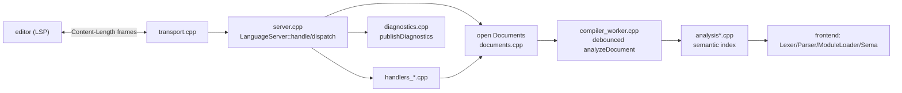

# a-lsp — language server

`tools/lsp/` implements **a-lsp**, a stdio LSP server for A, written in C++ and
linking the frontend libraries (`a_*` CMake targets) for lexing/parsing/sema.
Entry point `main.cpp` (`--version`/`--help`, binary-mode stdio on Windows,
then `LanguageServer::run()`).

## Architecture

- `server.hpp`/`server.cpp` — `class LanguageServer` (`kServerVersion = "0.0.1"`), document store `documents_`, request dispatch, `initialize`/`configuration`, shutdown lifecycle.
- `transport.cpp` — LSP stdio framing (read/write `Content-Length` messages), replies/notifications.
- `json.hpp`/`json.cpp` — minimal JSON (`jsonlite::Value`) reader/writer.
- `documents.cpp` — `Document` records (uri/path/text/version/`Compilation`), `didOpen`/`didChange`/`didSave`/`didClose`, tokenization.
- `compiler_worker.cpp` — async type checking: edits enqueue a `CompileJob` with 200 ms debounce (`kDebounceMs`), latest-wins; requests call `ensureCompiled()` for synchronous freshness (ty/pyrefly-style).
- `diagnostics.cpp`/`diagnostics.hpp` — publish/pull diagnostics from `DiagnosticSink`.
- `analysis.hpp`/`analysis.cpp`/`analysis_index.cpp`/`analysis_collect.cpp`/`analysis_resolve.cpp`/`analysis_internal.hpp` — semantic index over the compiler's own AST/sema: `Compilation` (graph+sema+per-module `FileIndex` with scopes/symbols/imports), `SymbolDef`, `ImportDef`, `ResolvedSymbol`, `resolveAt`/`resolveToken`, `visibleSymbols`, `CallSite` collection, `TypeDeclInfo`.
- `docs.hpp`/`docs.cpp` — signature rendering, doc extraction, builtin/method documentation tables (mirrors `builtin_docs_*.hpp`/`method_signatures.hpp`).
- `text_utils.hpp`/`text_utils.cpp` — path/URI, UTF-16↔byte column conversion, LSP range helpers.
- `handlers_*.cpp` — LSP methods: navigation (definition/references/rename/highlights), formatting + folding, symbols/hover, completion + signature help, semantic tokens/inlay hints/code actions/selection ranges, call/type hierarchy, code lens, document links, pull diagnostics (`textDocument/diagnostic`), moniker.
- `smoke_test.py` — Python smoke test driving the server (`python3 tools/lsp/smoke_test.py build/a-lsp`).

## How it fits

Built as target `a-lsp` (`tools/lsp/CMakeLists.txt`); tested by the
`language-server-smoke` CTest when Python 3 is present. The VS Code extension
(`tools/vscode-a/`) spawns it. Related: [Tooling (fmt/doc)](frontend-tooling.md),
[overview](overview.md).
